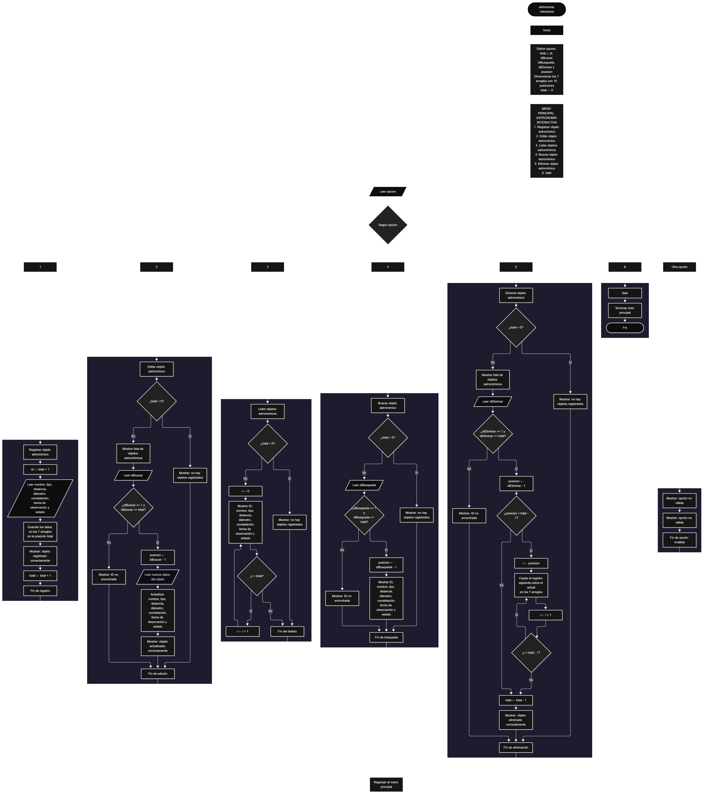

Este proyecto, llamado <b>astronomía interactiva</b>, fue desarrollado en <b>Java</b> como un ejercicio práctico para fortalecer la lógica de programación mediante la creación de un sistema de gestión de objetos astronómicos desde la consola. El programa cuenta con un menú principal de seis opciones que permite <b>registrar, editar, listar, buscar y eliminar objetos astronómicos</b>, además de salir del sistema. Cada objeto almacena datos como el nombre, el tipo, la distancia aproximada, el diámetro, la constelación, la fecha de observación y el estado de observación, utilizando arreglos con una capacidad máxima de <b>10 objetos durante la ejecución</b>. Durante su desarrollo se aplicaron conceptos fundamentales de programación, como variables, arreglos, estructuras condicionales, ciclos repetitivos y estructuras de selección, además de procesos para buscar, modificar, eliminar y organizar registros. Este proyecto permite poner en práctica los conocimientos adquiridos en Java y sirve como base para desarrollar sistemas de gestión más avanzados utilizando otros lenguajes y tecnologías.

<h2 align="center">⚙️ Funcionamiento del menú principal</h2>

### ➕ Registrar objeto astronómico

La opción <b>1) registrar objeto astronómico</b> permite registrar un nuevo objeto en el sistema. Antes de realizar el registro, el programa calcula el identificador mediante la expresión <b>total + 1</b>, mostrando el ID correspondiente al objeto que se va a registrar. Después, solicita el <b>nombre, tipo de objeto, distancia aproximada en millones de km, diámetro en km, constelación, fecha de observación y estado de observación</b>. Los datos se almacenan en la posición correspondiente de sus respectivos arreglos. Finalmente, muestra el mensaje <b>"Objeto astronomico registrado correctamente."</b> y aumenta la variable <b>total</b> en uno para actualizar la cantidad de objetos registrados.

### ✏️ Editar objeto astronómico

La opción <b>2) editar objeto astronómico</b> permite modificar la información de un objeto registrado. Primero, el programa comprueba si existen objetos almacenados mediante la condición <b>total == 0</b>. Si no hay registros, muestra el mensaje <b>"No existen objetos astronomicos registrados."</b>. En caso contrario, presenta una lista con el ID, nombre, tipo, distancia, diámetro, constelación, fecha de observación y estado de cada objeto. Después, solicita el ID del objeto que se desea editar y comprueba que esté dentro del rango permitido mediante la condición <b>idBuscar &gt;= 1 &amp;&amp; idBuscar &lt;= total</b>. Si la selección es válida, obtiene la posición mediante <b>idBuscar - 1</b> y solicita el nuevo nombre, tipo, distancia, diámetro, constelación, fecha de observación y estado de observación, actualizando directamente los valores de los arreglos correspondientes. Finalmente, presenta el mensaje <b>"Objeto astronomico actualizado correctamente."</b>. Si el ID seleccionado no corresponde a un objeto registrado, muestra el mensaje <b>"ID no encontrada."</b>.

### 📋 Listar objetos astronómicos

La opción <b>3) listar objetos astronómicos</b> permite visualizar todos los objetos registrados actualmente en el sistema. Antes de mostrar la información, el programa comprueba si la variable <b>total</b> es igual a cero. Si no existen registros, presenta el mensaje <b>"No existen objetos astronomicos registrados."</b>. Si hay objetos disponibles, utiliza un ciclo <b>for</b> para recorrer los arreglos desde la primera posición hasta el número total de objetos registrados. Durante el recorrido, muestra el ID, nombre, tipo, distancia aproximada en millones de km, diámetro en km, constelación, fecha de observación y estado de observación de cada objeto. Esta función facilita consultar los registros existentes sin necesidad de buscar cada objeto individualmente.

### 🔎 Buscar objeto astronómico

La opción <b>4) buscar objeto astronómico</b> permite localizar un objeto mediante su identificador. Primero, el programa comprueba si existen objetos registrados. Si no hay información almacenada, muestra el mensaje <b>"No existen objetos astronomicos registrados."</b>. En caso contrario, solicita el ID del objeto que se desea buscar y verifica que esté dentro del rango permitido mediante la condición <b>idBusqueda &gt;= 1 &amp;&amp; idBusqueda &lt;= total</b>. Si el identificador es válido, obtiene su posición mediante <b>idBusqueda - 1</b> y muestra todos los datos del objeto astronómico encontrado: nombre, tipo, distancia, diámetro, constelación, fecha de observación y estado de observación. Si el ID introducido no corresponde a ningún objeto registrado, presenta el mensaje <b>"ID no encontrada."</b>.

### 🗑️ Eliminar objeto astronómico

La opción <b>5) eliminar objeto astronómico</b> permite eliminar un objeto registrado mediante su identificador. Antes de comenzar, el programa comprueba que existan objetos almacenados. Si no hay registros, muestra el mensaje <b>"No existen objetos astronomicos registrados."</b>. Si hay objetos disponibles, presenta una lista con el ID, nombre, tipo, distancia, diámetro, constelación, fecha de observación y estado de cada uno. Después, solicita el ID del objeto que se desea eliminar y verifica que esté dentro del rango válido mediante la condición <b>idEliminar &gt;= 1 &amp;&amp; idEliminar &lt;= total</b>. Si el objeto existe, obtiene su posición mediante <b>idEliminar - 1</b> y comienza el proceso de eliminación. Para mantener los registros organizados, utiliza un ciclo <b>for</b> controlado por la variable <b>i</b>, que desplaza una posición hacia atrás los datos de los objetos posteriores en los arreglos <b>nombres, tipos, distancias, diametros, constelaciones, fechasObservacion y estados</b>. Posteriormente, disminuye la variable <b>total</b> en uno y muestra el mensaje <b>"Objeto astronomico eliminado correctamente."</b>. Si el ID seleccionado no corresponde a un objeto registrado, presenta el mensaje <b>"ID no encontrada."</b>.

### 🚪 Salir del menú principal

La opción <b>6) salir</b> está destinada a finalizar la ejecución del programa y muestra el mensaje <b>"Gracias por utilizar Astronomia Interactiva."</b>. El menú principal se encuentra dentro de una estructura repetitiva <b>do-while</b>, que mantiene el programa en funcionamiento mientras se realizan las operaciones disponibles. La condición final es <b>opcion != 6</b>, por lo que al seleccionar la opción 6 el ciclo termina y el programa ejecuta la instrucción <b>entrada.close()</b> para cerrar el objeto Scanner y finalizar la ejecución.

<h2 align="center">🧠 Temas aplicados en el proyecto</h2>

### 📦 Variables

En este proyecto se utilizan variables para guardar la opción seleccionada en el menú, controlar la cantidad de objetos astronómicos registrados, recorrer los arreglos, seleccionar los objetos que se desean editar, buscar o eliminar y determinar la posición correspondiente dentro de los arreglos. Cada variable cumple una función específica dentro de las operaciones de gestión de objetos astronómicos.

🔢 **Opcion:** Almacena la opción seleccionada por el usuario en el menú principal.

📊 **Total:** Almacena la cantidad actual de objetos astronómicos registrados.

🔄 **I:** Funciona como contador en los ciclos <b>for</b> y permite recorrer los arreglos y desplazar los datos durante la eliminación.

🆔 **Id:** Almacena el identificador calculado para el nuevo objeto astronómico que se va a registrar.

✏️ **IdBuscar:** Almacena el identificador introducido por el usuario para seleccionar el objeto que desea editar.

🔎 **IdBusqueda:** Almacena el identificador utilizado para buscar un objeto astronómico.

🗑️ **IdEliminar:** Almacena el identificador del objeto que se desea eliminar.

📍 **Posicion:** Almacena la posición correspondiente al objeto seleccionado dentro de los arreglos.

### 🗃️ Arreglos

En este proyecto se utilizan siete arreglos relacionados con los datos de cada objeto astronómico. Cada arreglo tiene una capacidad de <b>10 posiciones</b> y utiliza el mismo índice para representar la información correspondiente a un mismo objeto. Por ejemplo, los datos de un objeto almacenado en la posición <b>0</b> se encuentran distribuidos entre <b>nombres[0], tipos[0], distancias[0], diametros[0], constelaciones[0], fechasObservacion[0] y estados[0]</b>. Esta organización permite recorrer, buscar, modificar, mostrar y eliminar los objetos astronómicos de manera ordenada.

🪐 **Nombres[10]:** Almacena los nombres de los objetos astronómicos registrados.

🌌 **Tipos[10]:** Almacena los tipos de objetos astronómicos.

📏 **Distancias[10]:** Almacena las distancias aproximadas de los objetos en millones de kilómetros.

📐 **Diametros[10]:** Almacena los diámetros de los objetos en kilómetros.

✨ **Constelaciones[10]:** Almacena las constelaciones correspondientes a cada objeto.

📅 **FechasObservacion[10]:** Almacena las fechas de observación de los objetos astronómicos.

📊 **Estados[10]:** Almacena los estados de observación de cada objeto.

### 🔀 Estructuras condicionales

En este proyecto se utilizan las estructuras <b>if</b> y <b>else</b> para comprobar si existen objetos astronómicos registrados antes de realizar determinadas operaciones, verificar que el identificador seleccionado se encuentre dentro del rango permitido para editar, buscar o eliminar un objeto y determinar si se debe mostrar la información del registro seleccionado o presentar un mensaje cuando el ID no es válido. Estas condiciones permiten que el programa responda de manera diferente según el estado de los registros y el resultado de cada operación.

### 🔄 Estructuras repetitivas

En este proyecto se utilizan los ciclos <b>for</b> y <b>do-while</b>. Los ciclos <b>for</b> permiten recorrer los arreglos para mostrar los objetos astronómicos, presentar los registros antes de editarlos o eliminarlos y desplazar los datos de los objetos posteriores durante el proceso de eliminación. Por otro lado, el ciclo <b>do-while</b> mantiene activo el menú principal para que el usuario pueda ejecutar diferentes operaciones antes de salir del programa.

### 🎯 Estructura según

El programa evalúa el valor almacenado en la variable <b>opcion</b> mediante la estructura <b>switch</b> y ejecuta el bloque de instrucciones correspondiente. Cada caso representa una operación específica del sistema: <b>registrar, editar, listar, buscar, eliminar o salir</b>. También se utiliza el bloque <b>default</b> para mostrar el mensaje <b>"Opcion no valida."</b> cuando el valor introducido no coincide con ninguna de las opciones definidas en el menú. La instrucción <b>break</b> permite finalizar cada caso y continuar con el funcionamiento del menú principal.

### 🔢 Dimensionamiento de arreglos

El programa utiliza la instrucción <b>new</b> para establecer la capacidad de los arreglos que almacenan la información de los objetos astronómicos. Se definieron <b>10 posiciones</b> para cada uno de los siete arreglos, utilizando los tipos de datos <b>String</b> y <b>double</b> según la información que se necesita almacenar. La cantidad de posiciones ocupadas se controla mediante la variable <b>total</b>, por lo que las operaciones recorren únicamente los registros comprendidos entre la primera posición y el total actual de objetos astronómicos.

### 🔄 Reorganización de registros

Cuando se selecciona un objeto astronómico para eliminarlo, el programa utiliza un ciclo <b>for</b> que comienza en la posición seleccionada y llega hasta <b>total - 1</b>. En cada repetición, los datos de la posición siguiente se copian sobre la posición actual en los siete arreglos: <b>nombres, tipos, distancias, diametros, constelaciones, fechasObservacion y estados</b>. Después, la variable <b>total</b> disminuye en uno. De esta manera, los objetos posteriores ocupan las posiciones disponibles sin dejar espacios vacíos entre los registros activos.

<h2 align="center">¿Cómo se implementaron las operaciones crud en el proyecto?</h2>

Las operaciones <b>crud</b> se implementaron mediante las opciones del menú principal, permitiendo administrar los objetos astronómicos registrados. La operación <b>crear</b> corresponde a <b>registrar objeto astronómico</b>, donde se introducen los datos de un nuevo objeto; <b>leer</b> se realiza mediante las opciones <b>buscar objeto astronómico y listar objetos astronómicos</b>; <b>actualizar</b> corresponde a <b>editar objeto astronómico</b>, donde se modifican los datos de un objeto registrado; y <b>eliminar</b> se realiza mediante la opción <b>eliminar objeto astronómico</b>. Estas operaciones utilizan variables, arreglos, condicionales y ciclos para gestionar la información almacenada temporalmente durante la ejecución del programa.

<h2 align="center">Diagrama de flujo del proyecto</h2>

<h2 align="center">🛡️ Validaciones del programa</h2>

### 📭 No existen objetos astronómicos registrados

Esta validación se utiliza en las opciones de <b>editar, buscar y eliminar</b>, además de la opción de listar. El programa comprueba si la variable <b>total</b> es igual a <b>0</b> y, si no existen objetos registrados, muestra el mensaje <b>"No existen objetos astronomicos registrados."</b>. Esta comprobación evita continuar con las operaciones que necesitan información almacenada cuando el sistema se encuentra vacío.

### ❌ ID no encontrada

Esta validación se utiliza durante las operaciones de <b>editar, buscar y eliminar</b>. El programa comprueba que el identificador introducido por el usuario sea mayor o igual a <b>1</b> y menor o igual al valor de <b>total</b>. Si el ID se encuentra dentro del rango permitido, obtiene la posición correspondiente mediante la expresión <b>ID - 1</b> y ejecuta la operación seleccionada. En caso contrario, muestra el mensaje <b>"ID no encontrada."</b>, evitando acceder a una posición que no corresponde a un objeto registrado.

### ⚠️ Opción inválida

La estructura <b>switch</b> incluye el bloque <b>default</b>, que muestra el mensaje <b>"Opcion no valida."</b> cuando el usuario introduce un número que no corresponde a ninguna de las seis opciones definidas en el menú. Esta validación permite informar al usuario cuando selecciona una opción incorrecta.

### 🔢 Capacidad de almacenamiento

El programa utiliza arreglos con una capacidad máxima de <b>10 objetos astronómicos</b>. La variable <b>total</b> permite controlar la cantidad de objetos registrados durante la ejecución. Sin embargo, el código actual no incluye una condición que compruebe si se ha alcanzado el límite antes de registrar un nuevo objeto. Por este motivo, si se intenta almacenar más de 10 objetos, el programa puede generar un error al intentar acceder a una posición fuera de los límites del arreglo.

<h2 align="center">🎯 Objetivo del proyecto</h2>

El objetivo principal de este proyecto es fortalecer la <b>lógica de programación</b> mediante el desarrollo de un sistema de gestión de objetos astronómicos en <b>Java</b>. A través de su construcción se busca aplicar los conocimientos adquiridos sobre variables, arreglos, estructuras condicionales, ciclos repetitivos y estructuras de selección, integrándolos para resolver un problema de manera organizada. Además, el proyecto permite comprender cómo registrar, consultar, modificar y eliminar información en una aplicación de consola, estableciendo una base para desarrollar sistemas de gestión más completos con otros lenguajes y tecnologías.

